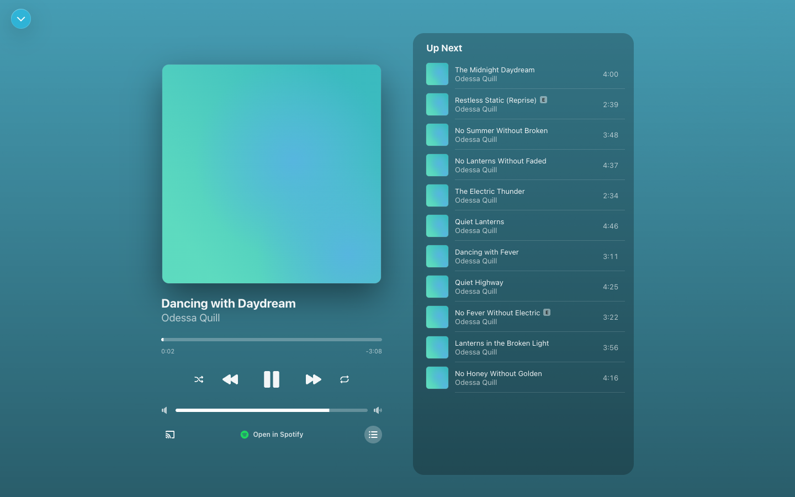

# Pane

A web player with a Liquid Glass interface that plays your own Spotify account.

Pane is a static web app. There is no server and nothing to sign up for: you connect it to Spotify with a developer app you create yourself, and everything stays in your browser.

> Pane is an unofficial, non-commercial project. It is not affiliated with, endorsed by, or connected to Spotify or Apple.


| Now Playing | Phone layout |
| --- | --- |
|  |  |

## What you need

- **Spotify Premium.** Spotify only allows in-browser playback for Premium accounts. Without it you can browse but not play.
- **Node.js 22 or newer** to run it locally.
- **A Chromium browser** (Chrome, Edge, Arc, Brave, Comet) for the full glass effect, where the glass bends what is behind it. Safari and Firefox get frosted glass instead.

## Try it without Spotify

```bash
git clone <this repo>
cd pane
npm install
npm run dev
```

Open **http://127.0.0.1:5173/** and choose **Look around first**. That loads a made-up library with generated artwork and a silent player, so you can click through every screen.

Use `127.0.0.1`, not `localhost`. Spotify refuses `localhost` as a redirect address, and Pane will tell you if you opened the wrong one.

## Connect your Spotify

Spotify limits a developer app in development mode to five named users, so Pane does not ship a shared app. Each person makes their own, which takes about two minutes and is free.

1. Open the [Spotify Developer Dashboard](https://developer.spotify.com/dashboard) and choose **Create app**. Any name and description will do.
2. Under **Redirect URIs**, add the address Pane shows on its setup screen. Running locally, that is `http://127.0.0.1:5173/`.
3. Tick **Web API** and **Web Playback SDK**, then save.
4. Open the app's settings and copy the **Client ID**.
5. Paste the Client ID into Pane and choose **Connect Spotify**.

You never need the Client Secret. Do not paste it anywhere.

To let a friend use your developer app instead of making their own, add their Spotify account under **User Management** in the dashboard (up to five people).

## What it does

- Home shelves built from your listening: recently played, top picks, heavy rotation, new releases from artists you follow, and your playlists.
- Your library: playlists, artists, albums, songs.
- Search across songs, artists, albums and playlists.
- Album, playlist and artist pages.
- Playback in the browser, with a mini player, a full Now Playing view, the queue, shuffle, repeat, volume, and switching between your Spotify Connect devices.
- Light and dark appearance, a frosted or solid fallback for the glass, and a reduce-motion setting.

## What Spotify does not allow

Spotify removed or restricted several parts of its Web API for new apps in 2026. Pane works within that:

- No editorial browsing: new releases, categories and featured playlists are gone, so there is no "New" or "Radio" tab.
- No "top songs" on artist pages.
- Track lists are only available for playlists you own or collaborate on. Other playlists still play; Pane shows a note in place of the list.
- Search returns ten results per group at a time; **Show more** loads the next ten.

## Privacy

Pane has no backend and no analytics. Your Client ID and Spotify tokens are kept in this browser's local storage. Requests go to Spotify (`accounts.spotify.com`, `api.spotify.com`, the Web Playback SDK, and Spotify's image servers) and nowhere else. **Settings → Disconnect Spotify** removes the tokens.

## Hosting it

`npm run build` produces a static site in `dist/` that works from any path on any HTTPS host. On a hosted copy, add that site's address as a Redirect URI in your Spotify app. Each visitor still needs their own Client ID.

## Development

```bash
npm run dev        # dev server on http://127.0.0.1:5173
npm test           # unit and component tests
npm run typecheck
npm run build
```

Screens talk to two interfaces, `MusicSource` and `PlayerEngine` (in `src/domain/types.ts`). Each has a demo implementation (`src/demo`) and a Spotify implementation (`src/spotify`), so the whole interface can be built and tested without an account. The glass material lives in `src/glass`. Design notes are in `docs/superpowers/specs`, and the layout measurements the interface was built to are in `docs/reference`.

Dependencies are installed with install scripts disabled (see `.npmrc`).

## Terms you are agreeing to

Using Pane with your Spotify account means your developer app is bound by the [Spotify Developer Terms](https://developer.spotify.com/terms) and [Developer Policy](https://developer.spotify.com/policy). Pane is for personal, non-commercial use. Spotify's policy restricts apps that replace its own client; whether to run one against your account is your call.

Pane contains no Apple or Spotify code, fonts, icons or artwork. Music, artwork and metadata shown while connected belong to Spotify and its licensors.

## Licence

MIT. See [LICENSE](LICENSE).
