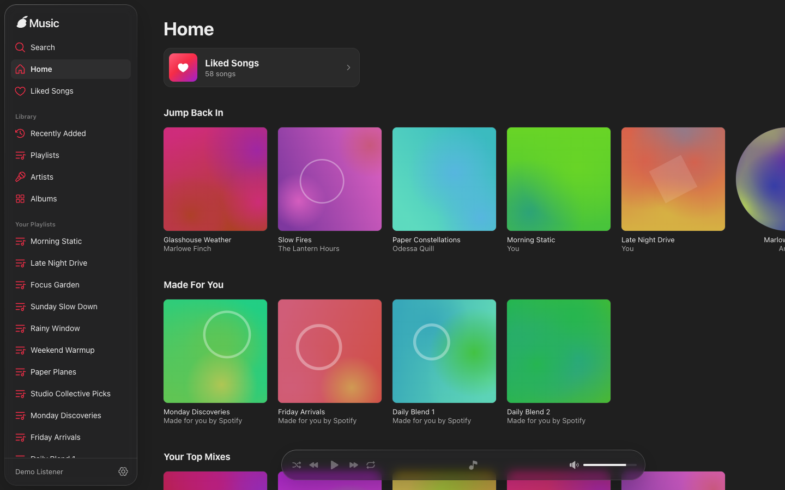
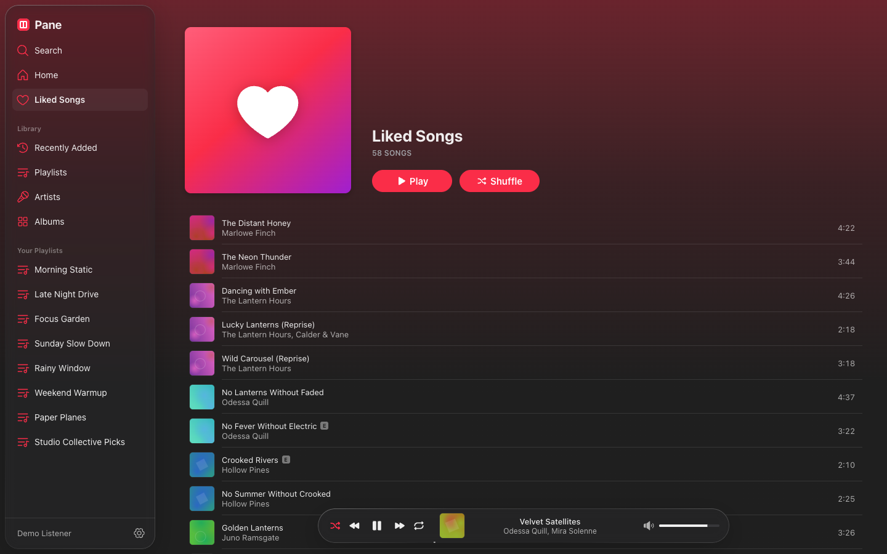
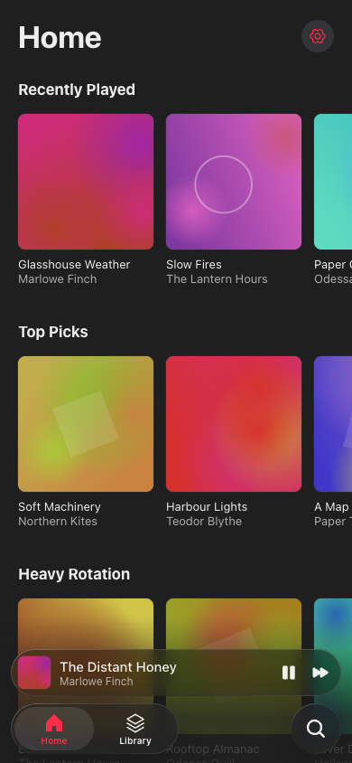
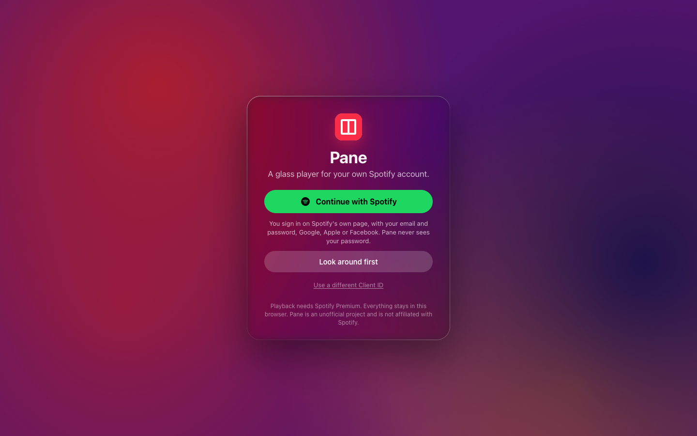

# Mango Music

A web player with a Liquid Glass interface that plays your own Spotify account.

Mango Music is a static web app. There is no server and nothing to sign up for: you connect it to Spotify with a developer app you create yourself, and everything stays in your browser.

> Mango Music is an unofficial, non-commercial project. It is not affiliated with, endorsed by, or connected to Spotify or Apple.



| Liked Songs | Now Playing | Phone layout |
| --- | --- | --- |
|  |  |  |

## What you need

- **Spotify Premium.** Spotify only allows in-browser playback for Premium accounts. Without it you can browse but not play.
- **Node.js 22.22.2 or newer** to run it locally (24.15+ and 26+ also work).
- **A Chromium browser** (Chrome, Edge, Arc, Brave, Comet) for the full glass effect, where the glass bends what is behind it. Safari and Firefox get frosted glass instead.

## Try it without Spotify

```bash
git clone <this repo>
cd pane
npm install
npm run dev
```

Open **http://127.0.0.1:5173/** and choose **Look around first**. That loads a made-up library with generated artwork and a silent player, so you can click through every screen.

Use `127.0.0.1`, not `localhost`. Spotify refuses `localhost` as a redirect address, and Mango Music will tell you if you opened the wrong one.

## Signing in



Signing in is one button, **Continue with Spotify**. It opens Spotify's own sign-in page, where you can use your email and password, Google, Apple or Facebook, and Spotify sends you back signed in. Mango Music never sees or stores your password, and it cannot offer its own password, Google or Apple sign-in: Spotify only signs people in to third-party apps on its own page.

### The one-time step

Spotify requires every app that plays its music to be registered, and limits an app in development mode to five named users. So Mango Music does not ship a shared registration; you make your own once. It is free and takes about two minutes.

1. Open the [Spotify Developer Dashboard](https://developer.spotify.com/dashboard) and choose **Create app**. Any name and description will do.
2. Under **Redirect URIs**, add the address Mango Music shows on its setup screen. Running locally, that is `http://127.0.0.1:5173/`.
3. Tick **Web API** and **Web Playback SDK**, then save.
4. Open the app's settings and copy the **Client ID**.

Then give Mango Music the Client ID in either of two ways:

- **Paste it on the first-run screen.** This browser remembers it, and from then on you only see the sign-in button.
- **Put it in the build.** Copy `.env.example` to `.env.local` and set `VITE_SPOTIFY_CLIENT_ID`. Mango Music then opens straight on the sign-in button for everyone using that copy, with no setup screen at all. `.env.local` is ignored by git.

A Client ID is a public identifier, not a secret. You never need the Client Secret; do not paste it anywhere.

To let friends use your copy, add their Spotify accounts under **User Management** in the dashboard (up to five people). Anyone beyond that needs their own Client ID, which they can enter with **Use a different Client ID** on the sign-in screen.

## What it does

- A Home that follows Spotify's own, as far as Spotify allows:
  - **Jump Back In**: the albums, playlists and artists you last played from.
  - **Made For You**: playlists Spotify made for you (Discover Weekly, Release Radar, Daily Mixes) that are saved in your library.
  - **Your Top Mixes**: On Repeat, Your Top Songs, All-Time Favourites and artist mixes, assembled by Mango Music from your own most-played songs.
  - **New Releases For You**: the latest from artists you follow or play most.
  - **Recently Played**, **Your Favourite Artists** and **Your Playlists**.
- **Liked Songs**, one click from Home and the sidebar: every song you have liked on Spotify, with its count, Play and Shuffle.
- Your library: playlists, artists and albums.
- Search across songs, artists, albums and playlists.
- Album, playlist and artist pages.
- Playback in the browser, with a mini player, a full Now Playing view, the queue, shuffle, repeat, volume, and switching between your Spotify Connect devices.
- Light and dark appearance, a frosted or solid fallback for the glass, and a reduce-motion setting.

## What Spotify does not allow

Spotify removed or restricted several parts of its Web API for new apps in 2026. Mango Music works within that:

- No editorial browsing: new releases, categories and featured playlists are gone, so there is no "New" or "Radio" tab.
- No access to Spotify's own recommendations. Since November 2024 Spotify closes its algorithmic playlists and its recommendation engine to new apps, and it has never offered its Home feed. So "Picked for you", Daily Mixes and Discover Weekly cannot be fetched. Two workarounds: the mixes Mango Music builds itself from your listening, and, for the Spotify-made playlists, saving them to your library in Spotify; those that Spotify then lists appear under Made For You and can be played, though their track lists stay hidden.
- No "top songs" on artist pages.
- Track lists are only available for playlists you own or collaborate on. Other playlists still play; Mango Music shows a note in place of the list.
- Search returns ten results per group at a time; **Show more** loads the next ten.
- Spotify offers no documented way to say "play my liked songs", so Mango Music starts playback from a list of tracks. Play uses up to 500 songs around where you start. Shuffle draws 500 at random from your first 1,000 liked songs.

## Privacy

Mango Music has no backend and no analytics. Among the permissions it asks Spotify for is your email address; Spotify's in-browser player will not start without that permission, and Mango Music never reads the address. Your Client ID and Spotify tokens are kept in this browser's local storage. Requests go to Spotify (`accounts.spotify.com`, `api.spotify.com`, the Web Playback SDK, and Spotify's image servers) and nowhere else. **Settings → Disconnect Spotify** removes the tokens.

## Hosting it

`npm run build` produces a static site in `dist/` that works from any path on any HTTPS host. On a hosted copy, add that site's address as a Redirect URI in your Spotify app. Each visitor still needs their own Client ID.

## Development

```bash
npm run dev        # dev server on http://127.0.0.1:5173
npm test           # unit and component tests
npm run typecheck
npm run build
```

Screens talk to two interfaces, `MusicSource` and `PlayerEngine` (in `src/domain/types.ts`). Each has a demo implementation (`src/demo`) and a Spotify implementation (`src/spotify`), so the whole interface can be built and tested without an account. The glass material lives in `src/glass`. Design notes are in `docs/superpowers/specs`, and the layout measurements the interface was built to are in `docs/reference`.

Dependencies are installed with install scripts disabled (see `.npmrc`).

## Terms you are agreeing to

Using Mango Music with your Spotify account means your developer app is bound by the [Spotify Developer Terms](https://developer.spotify.com/terms) and [Developer Policy](https://developer.spotify.com/policy). Mango Music is for personal, non-commercial use. Spotify's policy restricts apps that replace its own client; whether to run one against your account is your call.

Mango Music contains no Apple code, fonts, icons or artwork, and no Spotify code or artwork. The Spotify mark on the sign-in button comes from the open-source Phosphor icon set. Music, artwork and metadata shown while connected belong to Spotify and its licensors.

## Licence

MIT. See [LICENSE](LICENSE).
